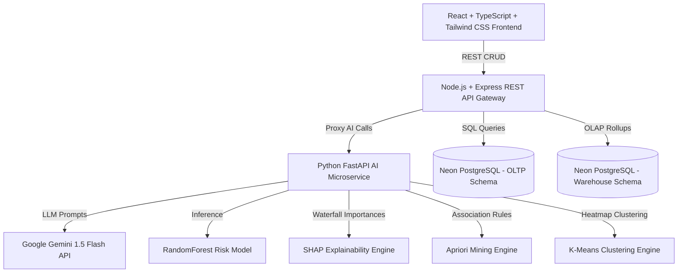

# SmartCart AI — Architecture Documentation

## System Architecture Summary

SmartCart AI is built as a microservice architecture:
1. **Frontend**: React + Vite + TypeScript + Tailwind CSS running on port 5173.
2. **Backend API Gateway**: Node.js + Express running on port 3001 connecting to Cloud PostgreSQL.
3. **AI Microservice**: Python + FastAPI running on port 8000 hosting all machine learning algorithms and LLM calls.
4. **Cloud Database**: Neon PostgreSQL hosting `oltp` schema for live transactions and `warehouse` star schema for historical mining.
